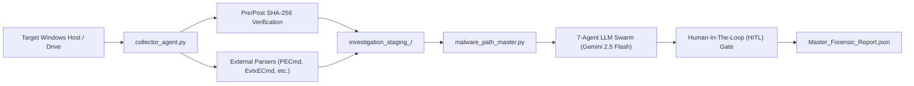

# AI-Assisted Digital Forensics & Incident Response (DFIR) Framework

An enterprise-grade, automated forensic acquisition and multi-agent AI threat hunting system for Windows endpoints.

> [!NOTE]
> For a detailed deep-dive into the architectural design, developer analysis, product strategy, and technical debt assessment, please refer to the comprehensive [OVERVIEW.md](file:///c:/Users/GH25225/Downloads/files%20%284%29/OVERVIEW.md).

---

## 📖 Quick Navigation

- [Overview & Architecture](#-overview--architecture)
- [System Requirements & Tools](#-system-requirements--tools)
- [Repository Structure](#-repository-structure)
- [Execution Workflow](#-execution-workflow)
- [Multi-Agent Swarm Overview](#-multi-agent-swarm-overview)
- [Security & Chain of Custody](#-security--chain-of-custody)
- [Key Insights & Roadmap](#-key-insights--roadmap)

---

## 🛠️ System Architecture

The framework operates via a decoupled 2-phase architecture:



1. **Evidence Collector Engine ([collector_agent.py](file:///c:/Users/GH25225/Downloads/files%20%284%29/collector_agent.py))**: Extracts artifacts matching [collector_paths.json](file:///c:/Users/GH25225/Downloads/files%20%284%29/collector_paths.json), audits file integrity using SHA-256 pre/post-copy hashing (`hash_manifest.csv`), extracts Autoruns/VSS/ADS, and runs automated forensic CLI tools (`PECmd`, `AmcacheParser`, `EvtxECmd`, `RegRipper`).
2. **AI Swarm Orchestrator ([malware_path_master.py](file:///c:/Users/GH25225/Downloads/files%20%284%29/malware_path_master.py))**: Launches specialized sub-agents ([malware_path_agents.py](file:///c:/Users/GH25225/Downloads/files%20%284%29/malware_path_agents.py)) built upon [core_agents.py](file:///c:/Users/GH25225/Downloads/files%20%284%29/core_agents.py). Each agent safely analyzes partitioned metadata, presents findings to a Human-In-The-Loop (HITL) terminal interface for approval/revision, and outputs a combined executive report.

---

## 📁 Repository Structure

```
.
├── collector_agent.py       # Main evidence acquisition & forensic tool parser engine
├── collector_paths.json     # Configuration defining 19 artifact target path categories
├── core_agents.py           # Core agent base class, Pydantic schemas, safe file reader & LLM connector
├── malware_path_agents.py   # 7 specialized forensic sub-agent implementations
├── malware_path_master.py   # Swarm orchestrator & master report aggregator
├── OVERVIEW.md              # Detailed 3-perspective technical architecture & system analysis
└── README.md                # System documentation & usage guide
```

---

## 🚀 Execution Workflow

### Step 1: Run Evidence Acquisition Engine
Extracts artifacts, executes tool parsers, and builds the staging directory:
```bash
python collector_agent.py
```
*Outputs: `investigation_staging_YYYYMMDD_HHMMSS/` containing raw files, parsed CSV metadata, `hash_manifest.csv`, and `execution_report.json`.*

### Step 2: (Optional) Inject Case Context
Add analyst notes or threat intelligence leads into `event_context.txt` in the root folder. All AI sub-agents will automatically incorporate this context into their system prompts.

### Step 3: Run AI Malware Path Master
Executes the sub-agent swarm against the newly created staging directory:
```bash
python malware_path_master.py
```
Or target a specific staging folder:
```bash
python malware_path_master.py /path/to/investigation_staging_20260719_140501
```

---

## 🤖 Multi-Agent Swarm

| Sub-Agent | Target Path / Category | Investigation Focus |
| :--- | :--- | :--- |
| **TempFolderAgent** | `TempFolder` | Dropped executables, obfuscated archives, script staging. |
| **DownloadsFolderAgent** | `Downloads` | Double extension lures, MOTW bypasses (ISO/IMG), rogue scripts. |
| **ProgramDataAgent** | `ProgramDataList` | Standalone binaries, hidden ransomware/cryptominer directories. |
| **ScheduledTasksAgent** | `SysinternalsAutoruns` (Tasks) | Persistence via tasks, base64 encoded PowerShell commands. |
| **ServicesAgent** | `SysinternalsAutoruns` (Services) | Privilege escalation, unquoted service paths, user-writable service images. |
| **DriversAgent** | `SysinternalsAutoruns` (Drivers) | Kernel rootkits, BYOVD (Bring Your Own Vulnerable Driver) attacks. |
| **AutorunsAgent** | `SysinternalsAutoruns` (Logon) | General startup keys (Run/RunOnce, Startup items, extensions). |

---

## 🔐 Safety & Forensic Integrity Controls

- **Executable Safety**: Executables (`.exe`, `.dll`, `.sys`, etc.) and binary hives (`.dat`, `.evtx`, `.pf`) are **never** opened, read as text, or disassembled. Only names, paths, sizes, and hashes are passed to LLMs.
- **Payload Truncation**: Inputs to the LLM are capped at 30,000 characters to prevent API context window overflow.
- **Chain of Custody**: Cryptographic verification before and after file transfer ensures no corrupted or tampered files are introduced into evidence.

---

## 📊 Summary of Insights & Key Recommendations

For the full detailed breakdown, refer to [OVERVIEW.md](file:///c:/Users/GH25225/Downloads/files%20%284%29/OVERVIEW.md).

1. **Security Hardening**: Purge the hardcoded API key in `core_agents.py` line 161 and replace `shell=True` subprocess calls.
2. **Web UI & HITL**: Replace terminal `input()` prompts with a FastAPI + WebSockets dashboard to allow true async parallel sub-agent execution.
3. **Chunking & Summarization**: Implement vector/map-reduce chunking for large log files exceeding the 30,000 character limit.

---
*Built for DFIR Analysts & Threat Hunters.*
